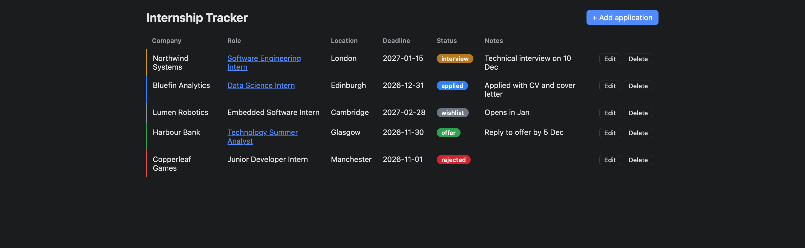
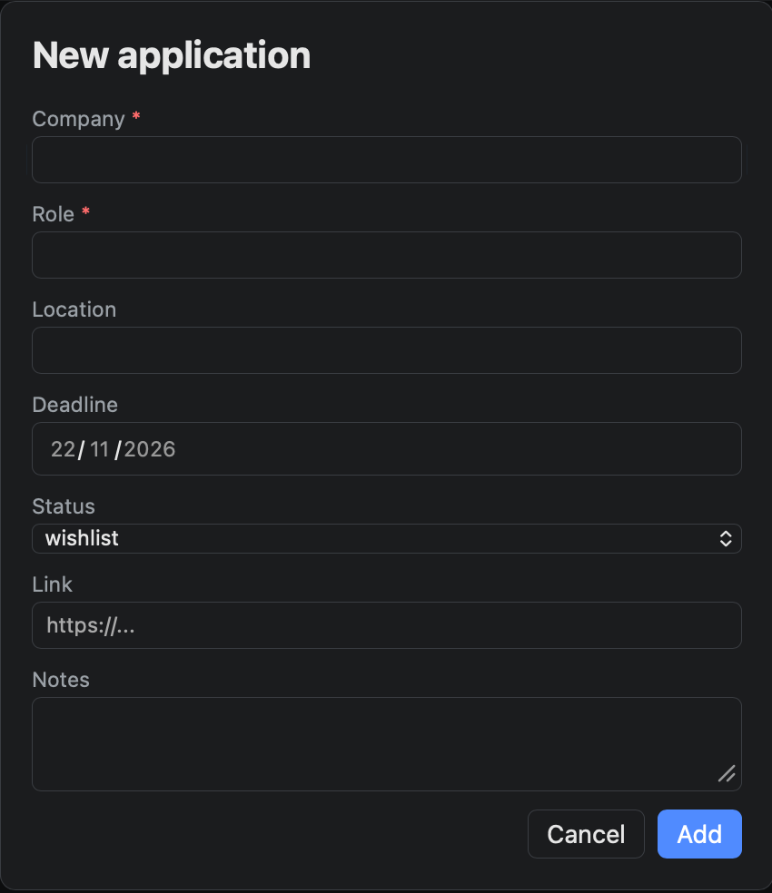
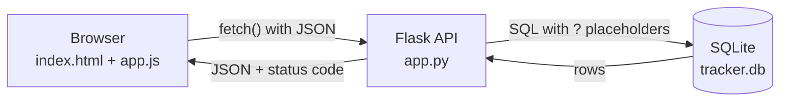

# Internship Tracker

**A small full-stack web app for keeping track of internship applications:**
where I applied, for which role, by when, and how far each one has got.




## Why I built it

I'm applying for internships, and I wanted one place to see every
application, its deadline and where it stands. Instead of using a
spreadsheet, I built the tool myself, to learn how a complete web app fits
together: a database, a REST API, tests, and a front end that talks to it.

## Features

- **Add, edit and delete** applications from one page, using a single pop-up
  form for both adding and editing.
- **Status tracking** through five stages: `wishlist` → `applied` →
  `interview` → `offer` / `rejected`. Each row is colour-coded: wishlist
  grey, applied blue, interview amber, offer green, rejected red.
- **Required fields are clear:** company and role are marked with a red `*`.
- **Helpful errors:** invalid input is rejected with a message shown in the
  form, not saved quietly.
- **Links:** the role becomes a clickable link to the job posting when one is
  saved.
- **Delete asks first**, so nothing is removed by a misclick.
- **Light and dark mode**, following the system setting.



## How it works



The page is a single HTML file. When it loads, the JavaScript asks the API for
every application and builds one table row per result. Adding or editing sends
the form as JSON with a `POST` or `PUT` request. If the API answers with a
success code, the table is reloaded. If it answers with an error, the message
appears in the form.

## Tech stack

| Part      | Tools                                         |
| --------- | --------------------------------------------- |
| Back end  | Python, Flask                                 |
| Database  | SQLite through Python's built-in `sqlite3`  |
| Front end | Plain HTML, CSS and JavaScript (no framework) |
| Testing   | pytest                                        |

## Getting started

You need Python 3 installed.

```bash
git clone https://github.com/werqu1ty/internship-tracker.git
cd internship-tracker

python3 -m venv .venv
source .venv/bin/activate
pip install -r requirements.txt

python db.py          # creates the database file tracker.db
flask run -p 5001
```

Then open **http://127.0.0.1:5001/**.

> Port 5001 is used because macOS uses port 5000 for AirPlay. Any free port
> works.

## Running the tests

```bash
python -m pytest
```

The 16 tests cover every API route, including the error cases:

- **Adding:** a valid application, missing role, a body that isn't a JSON
  object, an invalid status, the default status, and all fields saved.
- **Getting one:** found and not found.
- **Editing:** found, not found, missing role, a body that isn't a JSON
  object, an invalid status, and all fields edited.
- **Deleting:** found (and gone afterwards) and not found.

Each test runs against its own temporary database, so the tests never touch
the real `tracker.db`.

## API reference

| Method     | Address                    | Success | Errors                            |
| ---------- | -------------------------- | ------- | --------------------------------- |
| `GET`    | `/api/applications`      | 200     |                                   |
| `POST`   | `/api/applications`      | 201     | 400 invalid input                 |
| `GET`    | `/api/applications/<id>` | 200     | 404 no such id                    |
| `PUT`    | `/api/applications/<id>` | 200     | 400 invalid input, 404 no such id |
| `DELETE` | `/api/applications/<id>` | 200     | 404 no such id                    |

Example: adding an application from the command line.

```bash
curl -X POST http://127.0.0.1:5001/api/applications \
     -H "Content-Type: application/json" \
     -d '{"company": "Example Ltd", "role": "Software Intern", "status": "applied"}'
```

```json
{"message": "Application added!"}
```

**Rules the API checks:**

- The body must be a JSON object.
- `company` and `role` are required.
- `status` must be one of the five stages and defaults to `wishlist`.
- `PUT` replaces the whole application, so fields that are left out are
  cleared.

## Data model

One table, `applications`:

| Column         | Type    | Notes                                         |
| -------------- | ------- | --------------------------------------------- |
| `id`         | integer | primary key, set automatically                |
| `company`    | text    | required                                      |
| `role`       | text    | required                                      |
| `location`   | text    | optional                                      |
| `deadline`   | text    | optional, `YYYY-MM-DD`                      |
| `status`     | text    | one of the five stages, default `wishlist`  |
| `notes`      | text    | optional                                      |
| `link`       | text    | optional, link to the job posting             |
| `source`     | text    | where the entry came from, default `manual` |
| `source_url` | text    | unique, reserved for importing listings later |
| `created_at` | text    | set automatically                             |

## Design decisions

- **Input is checked before the database is opened.** Bad requests are
  rejected early with a `400`. A missing id gets a `404`, so the two kinds of
  error stay distinct.
- **Status is checked in two places:** in the API, and by a `CHECK` rule in
  the database itself. Bad data can't get in, even by a route that forgets to
  check.
- **No SQL injection:** every value goes into the SQL through `?`
  placeholders and is never pasted into the query text.
- **Safe display:** the front end writes user data into the page as plain
  text (`textContent`), so typed text can never turn into HTML. Saved links
  are only allowed to be web addresses.
- **Isolated tests:** a pytest fixture points the app at a temporary database
  file for each test.
- **Ready for imports:** `source` and the unique `source_url` column mean a
  future automatic import can never create duplicates.

## Project structure

```text
internship-tracker/
├── app.py              # Flask app: the page and the five API routes
├── db.py               # database connection and setup
├── schema.sql          # the applications table
├── requirements.txt
├── docs/               # screenshots for this README
├── templates/
│   └── index.html      # the page and the pop-up form
├── static/
│   ├── app.js          # fetching, rendering, add/edit/delete
│   └── style.css       # layout, status colours, light/dark mode
└── tests/
    └── test_api.py     # 16 API tests
```

## Ideas for later

- Import listings automatically from an official job API (such as Reed or
  Adzuna), without creating duplicates
- Alerts for new listings that match my preferences
- Filtering and sorting the table
- Deploying it online

## How I built it

I wrote the back end (Flask API and SQLite database), the tests, and the
core front-end logic myself, in small commits. I used an AI coding assistant
(Claude Code) as a tutor and code reviewer, and to help build the rest of
the front end (the add/edit form, buttons and styling).
